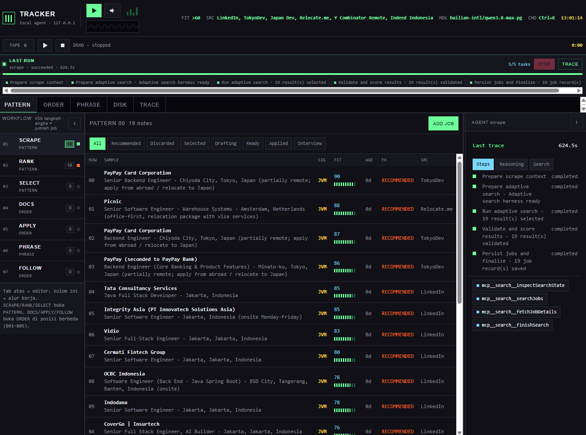
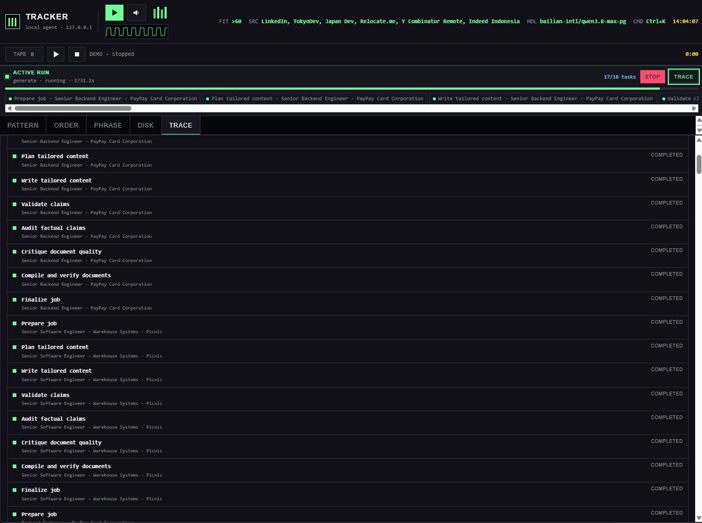
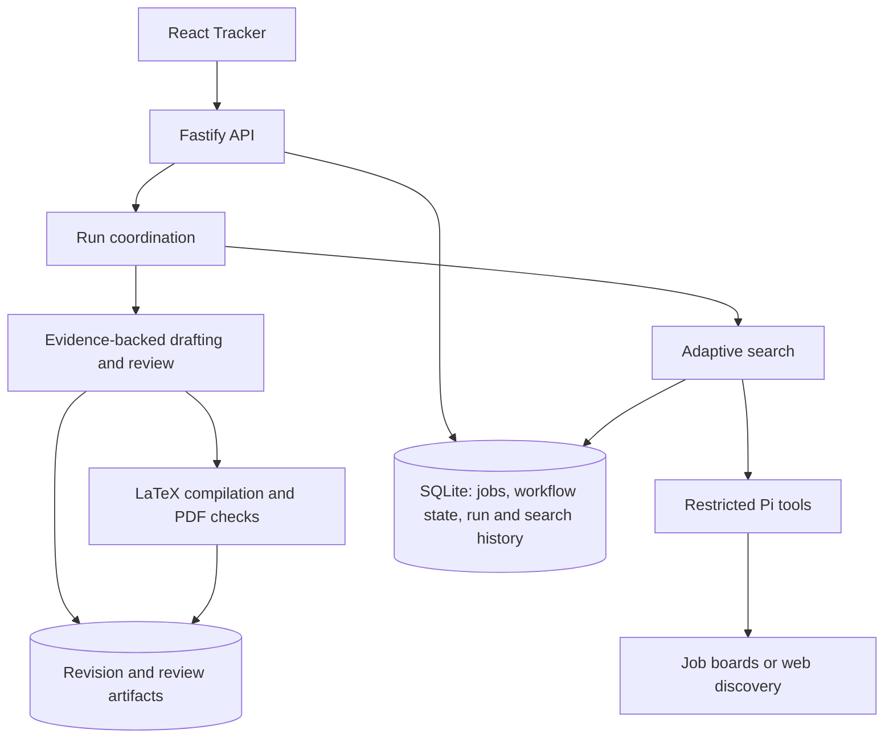

# Job Sequencer

**AI agents discover and rank jobs, tailor your application documents, and put you in control of which opportunities to pursue and which drafts to approve.**

[](https://github.com/chndranndr/job-sequencer/actions/workflows/ci.yml)

Job hunting means repeating searches across boards, comparing postings, and tailoring documents. Job Sequencer brings that work into one local workspace so you can review a ranked shortlist and decide which jobs to pursue.

Built with TypeScript, React, Vite, Fastify, Node.js SQLite, and the Pi agent runtime. You start workflows, select jobs, approve drafts, and submit applications yourself. Internal search and drafting steps run automatically within those boundaries.

<p align="center">
  
</p>

Real job-search results from a local run on an earlier Qoder-backed version of Tracker. The current repository uses Pi. Postings and AI-generated fit assessments reflect that capture, not current vacancy availability.

<details>
  <summary>See the document-generation trace with real job data</summary>

  <p>
    
  </p>

  <p>The trace shows completed per-job checks while the overall generation run is still in progress.</p>
</details>

[Watch the separate 24-second fixture walkthrough](docs/assets/job-sequencer-walkthrough.gif). The GIF uses deterministic sample data, not the real postings shown above.

[Verify without credentials](#verify-without-provider-credentials) · [Run locally](#requirements-and-installation) · [Documentation map](docs/index.md)

## Engineering highlights

- **Adaptive search with enforced limits.** Seven built-in sources share a search harness that adapts queries and pagination from source coverage and observed yield. Call, result, time, and source quotas bound exploration; detail fetching checks same-run provenance. See [search state](src/server/search/state.ts) and [behavioral tests](tests/agent-search.test.ts).
- **Evidence-backed document generation.** Structured drafts carry profile evidence references. Deterministic claim validation checks references and selected unsupported claims; a separate factual-auditor agent reviews semantic overclaims. Critical factual findings trigger bounded revision or block finalization. These checks do not guarantee factual accuracy. See [claim validation](src/server/agents/claim-validator.ts) and [generation](src/server/generation.ts).
- **PDF checks before approval.** Generation compiles LaTeX documents and checks page counts and extracted text. Successful document verification is required before a draft can become Ready. See [document checks](src/server/documents.ts).
- **Restricted agent tools and inspectable runs.** Search receives typed search, detail, state-inspection, and finish tools instead of shell access. Run status, trajectory events, usage, and search-attempt history persist locally; document revisions retain their review artifacts.
- **Fixture-based verification.** [Trajectory evaluations](tests/trajectory-evals.test.ts) exercise multi-step search behavior. [Prompt-boundary tests](tests/injection.test.ts) and [browser smoke](scripts/browser-smoke-tracker.ts) cover additional failure paths without requiring live provider calls.

## The product loop

1. Save a profile and optional search preferences in **DISK**.
2. Start a bounded search from **PATTERN**, then review ranked jobs and their evidence in **SAMPLE**.
3. Select jobs yourself before starting document generation.
4. Review generated drafts and approve them before recording **Applied**.
5. Practice interviews in **PHRASE**, draft follow-ups in **ORDER**, and inspect runs in **TRACE**.

The chiptune-inspired Tracker names map to ordinary job-search tasks:

| View | Purpose |
|---|---|
| DISK | Profile, search preferences, sources, and model settings |
| PATTERN | Search and ranked job shortlist |
| SAMPLE | Job details and matching evidence |
| ORDER | Application tracking, documents, and follow-up drafts |
| PHRASE | Interview practice and feedback |
| TRACE | Run history, tool activity, usage, and search coverage |

The app never submits applications or sends messages. Generation leaves documents in Drafting; approval to Ready and recording Applied are separate user actions.

## Architecture and trade-offs



Search and generation are separate user-initiated workflows, not an automatic search-to-apply pipeline. The browser calls the API through [`src/api.ts`](src/api.ts); the API owns workflow state, run coordination, persistence, and approval boundaries.

- **Local storage, no hosted account.** Built-in `node:sqlite` avoids a separate database service. The supported runtime is Node 24.x; this is a single-user, loopback-only application without user authentication or cloud sync.
- **Code checks plus model review.** Deterministic validation covers explicit evidence rules; factual review addresses semantic claims but remains fallible. Human review is still required.
- **LaTeX output, external toolchain.** Templates and PDF checks support controlled document layout, at the cost of local TeX and PDF utilities.
- **History, not resumable agents.** Run records and artifacts persist, but Pi sessions are in memory. An interrupted run is not a durable execution checkpoint.

## Requirements and installation

- Windows 10+ for the documented local workflow.
- Node.js 24.x and npm, matching the package's `>=24 <25` runtime range.
- Bun for vendored job-source CLIs and their tests. CI uses Bun 1.4.0.
- For PDF generation: both `lualatex` for CVs and `xelatex` for cover letters, plus `pdfinfo` and `pdftotext`.
- For optional web discovery: a connected BrowserSkill CLI and extension. See [setup and limits](#web-discovery-optional).

Check the runtime, then install from the repository root:

```bash
node --version
npm --version
bun --version
npm ci
```

The application uses Node/TypeScript. The vendored FreeHire, LinkedIn, and Japan board CLIs remain Bun-based; Relocate.me reuses the Japan-board CLI, while Y Combinator Remote and Indeed Indonesia use bounded public HTML adapters.

## Verify without provider credentials

After installation, run the same fixture-based checks used by CI:

```bash
npm run check
npm test
npm run eval
```

These commands do not require live LLM credentials or a local TeX installation. CI uses Node 24 and Bun; Bun is also needed for the vendored source CLIs and their separate tests. `check` runs whitespace checks, both TypeScript targets, documentation-link validation, manifest validation, and architecture-boundary checks. `eval` runs selected AI fixtures, server integration tests, and trajectory evaluations.

For an interactive fixture-backed UI check, run `npm run smoke:browser` with Playwright's Chromium installed. See [verification commands](#verification-commands) for toolchain-specific and live checks.

## Configure Pi authentication

The dashboard does **not** accept or display API keys. Pi resolves credentials from its normal auth store or from environment variables.

### Option A — Pi login (recommended)

Use the local Pi CLI bundled by this project:

```bash
npx --no-install pi
```

Inside Pi, run:

```text
/login
```

Choose the provider and complete its API-key or OAuth flow. Credentials are stored in:

```text
%USERPROFILE%\.pi\agent\auth.json
```

Do not copy this file into the repository or commit it.

**ChatGPT/Codex login uses provider `openai-codex`, not `openai`.** Verify it with:

```bash
npx --no-install pi auth check --provider openai-codex --model gpt-5.6-luna
```

### Option B — environment variable

Use the variable matching the provider:

| Pi provider | Environment variable |
|---|---|
| `google` | `GEMINI_API_KEY` |
| `anthropic` | `ANTHROPIC_API_KEY` |
| `openai` (API key) | `OPENAI_API_KEY` |
| `openai-codex` (ChatGPT/Codex OAuth) | Use Pi `/login`; no `OPENAI_API_KEY` required |

Git Bash:

```bash
export GEMINI_API_KEY="<your-key>"
```

PowerShell:

```powershell
$env:GEMINI_API_KEY = "<your-key>"
```

Set the variable before starting the backend. Never put a real key in `data/`, `README.md`, or `data/settings.json`.

### Check provider readiness

```bash
npx --no-install pi auth check --provider google
npx --no-install pi auth check --provider anthropic
npx --no-install pi auth check --provider openai
```

Run only the check for the provider you use. Add `--model <exact-model-id>` when you want to validate a specific model. Do **not** use `--credentials` because it prints the resolved secret.

The dashboard Settings dropdown is populated from Pi's authenticated model catalog, so it lists providers with available models and filters models by the selected provider. After choosing a provider and model, save, then run **Test connection**.

List available model IDs when needed:

```bash
npx --no-install pi --list-models
```

## Run the application

The frontend and API run as two local processes. Build the backend first:

```bash
npm run build
```

**Terminal 1 — API server:**

```bash
npm start
```

**Terminal 2 — Vite frontend:**

```bash
npm run dev
```

Open:

```text
http://127.0.0.1:5173
```

Tracker is the only frontend. `/tracker.html` remains a compatibility entry for the same app; no secondary frontend route is supported.

The API is available at `http://127.0.0.1:3000`; verify it with:

```bash
curl http://127.0.0.1:3000/health
```

Vite proxies `/api` and `/health` to the backend. After changing server-side TypeScript, run `npm run build` again and restart the long-lived API process; after frontend/source-control changes, restart the long-lived Vite process too. Do not kill user-managed ports blindly. The server is loopback-only; do not expose it to the LAN.

## First-run checklist

1. Open **DISK** and enable the job sources to search: FreeHire, LinkedIn, TokyoDev, Japan Dev, Relocate.me, Y Combinator Remote, or Indeed Indonesia.
2. Select an authenticated Pi provider from DISK's catalog-backed dropdown.
3. Choose a model from the authenticated Model dropdown and save settings. The model field is non-secret configuration only.
4. Click **Test connection**. The credential remains in Pi auth storage/environment variables.
5. Open **DISK**, review and save the structured profile. Add search preferences when useful; they steer discovery but are not required.
6. Use **PATTERN** to scrape and review jobs. Select jobs manually before generating documents.

### Source coverage and posting age

A scrape attempts each enabled healthy source at the configured minimum when search-call, result-slot, and source request quotas allow. Failures and unsearched sources remain visible in TRACE.

Each built-in source has an editable maximum age in days. FreeHire, LinkedIn, Relocate.me, Y Combinator Remote, and Indeed Indonesia default to `9999`, effectively no cutoff; TokyoDev and Japan Dev default to 45 days. Increasing a source above 45 days adds a warning to verify older postings are still active. Custom sources keep their bounded declarative HTTP(S) controls and do not require a posted-date field.

### Profiles and document exports

The canonical profile is `data/profile.json`. A legacy `data/profile.md` is preserved for review/import and is not overwritten automatically. Runtime data and generated applications are under gitignored `data/`.

After each successful document generation, PDF copies are also saved in `data/generated/<company>_<role>_<UTC-timestamp>-<unique-suffix>/`, for example `cv_example_engineer.pdf` and `cover_letter_example_engineer.pdf`. Open this folder directly in File Explorer to collect the PDFs. Each generation has its own folder, so revisions and matching job names never overwrite earlier exports. These are drafts until approved in the app. Existing documents are exported on their next successful generation; exports remain until manually deleted.

## Web discovery (optional)

Choose **Web discovery** in DISK or the scrape confirmation preferences, save, then start a scrape. **Job boards** remains the default and retains its existing source selections. Discovery uses the saved profile and optional preferences to search the web, follow company careers/ATS links, read individual postings, and score them into the same dashboard. It never fills or submits applications. Search snippets and careers index pages should not be returned as jobs.

Install the [BrowserSkill CLI](https://github.com/Tencent/BrowserSkill/blob/main/AGENT_INSTALL.md) locally. On Windows, its documented installation command is:

```powershell
irm https://raw.githubusercontent.com/Tencent/BrowserSkill/main/install.ps1 | iex
```

The backend finds `bsk.exe` under `%USERPROFILE%\.local\bin` or `bsk` on PATH. Install the [BrowserSkill extension](https://chromewebstore.google.com/detail/hhcmgoofomhgciiibhipgmgkgnoenaoi) in your browser and enable its local connection. BrowserSkill officially supports Chrome/Edge; Brave compatibility must be checked on this machine. Run `bsk doctor` after connecting. With multiple connected browsers, use `bsk browsers --json` and set `BSK_BROWSER` to the intended Brave instance ID before starting the backend.

Each discovery run creates its own background Agent Window and attempts to close only that session on completion, cancellation, or failure. Login, consent and CAPTCHA require manual browser action; discovery reports a setup/verification error rather than bypassing them. The backend exposes only `searchWeb` and `readWebPage`, with fixed page extraction, same-run link provenance, six searches, 24 page reads, and a five-minute agent budget. Jobs retain source URLs and page evidence, and TRACE records searches, read pages and counts. It does not use the job-board adapters' MAX age values or a fixed 14-day cutoff; explicitly expired/closed postings are excluded by the agent, and uncertain dates are flagged.

Requested URLs and settled destinations are checked for public HTTP(S), DNS addresses and credential-bearing links. Known job-board hosts are blocked, but the finite list is not an exhaustive source-identity guarantee; verify the employer and individual posting. This is not a browser network firewall: redirects and page subresources run inside the browser. Live acceptance requires a connected browser and an explicitly requested provider-backed scrape; deterministic tests use fixtures.

## Verification commands

| Command | Purpose and prerequisites |
|---|---|
| `npm run typecheck` | Frontend and backend TypeScript checks. |
| `npm run check` | Whitespace, types, documentation links, manifest, and architecture boundaries. |
| `npm test` | Fixture-based unit and integration tests. |
| `npm run eval` | Selected AI fixtures, server tests, and trajectory evaluations. No live provider calls. |
| `npm run build` | Compile the server and bundle the frontend. Does not restart running processes. |
| `npm run test:vendor:freehire` | Vendored FreeHire tests; requires Bun. |
| `npm run smoke` | Small SQLite and faux-provider Pi probe, not a full API workflow check. |
| `npm run smoke:browser` | Fixture API/frontend plus real Chromium interactions; requires Playwright's browser installation. |
| `npm run smoke:latex` | Local document compilation and PDF checks; requires TeX and PDF utilities. |
| `npm run doctor` | Full local harness: link/architecture checks, whitespace, types, tests, and evaluations. Not a TeX or provider-readiness probe. |
| `npm run gc -- --dry-run` | Preview removal of build/cache outputs. Omit `--dry-run` only when you intend to remove them. |
| `npm run live:scrape` | Explicitly live, network-dependent source check, capped at five jobs. Not an offline verification step. |

`smoke:browser` starts fixture API/frontend processes, opens Tracker, exercises PATTERN/ORDER/PHRASE/SAMPLE/DISK/TRACE, and checks console/page/request errors plus desktop/mobile overflow. `smoke:browser:tracker` is an alias for the same command.

`smoke:latex` uses temporary files and fixed executable argument arrays. It exits non-zero when a compiler or PDF verifier is unavailable. Install Chromium with `npx playwright install chromium` before running browser smoke if it is not already available.

## Continuous integration

GitHub Actions runs `npm run check`, `npm test`, and `npm run eval` for pushes and pull requests. The workflow is [`.github/workflows/ci.yml`](.github/workflows/ci.yml).

## Workflow and safety boundaries

- Profile facts are serialized deterministically for each provider workflow.
- Pi sessions disable ambient skills, extensions, prompt templates, themes, context discovery, and unrestricted built-in tools where the workflow requires it.
- Job-board scraping exposes typed `searchJobs` and `fetchJobDetails` wrappers, plus state-inspection and finish tools. Built-in sources use vendored CLIs or bounded public HTML adapters; custom sources use bounded HTTP(S) URL templates and data-only JSON paths or simple HTML selectors. Web discovery uses the separate restricted tools described above. No arbitrary commands or user code are accepted.
- Workflows are user-initiated: scraping does not automatically select jobs, generate documents, apply, start interview practice, or send follow-ups.
- Document generation stops at `Drafting`; explicit approval is required for `Ready`, and explicit manual recording is required for `Applied`.
- There is no user authentication, CORS, cloud sync, job submission, email sending, or automatic provider fallback.
- Keep credentials in Pi auth storage or environment variables. Never commit `auth.json`, `.env` files, API keys, tokens, or generated personal data.

## Further documentation

- [Repository knowledge map](docs/index.md): maintained documentation, architecture boundaries, and quality checks.
- [Product intent](IDEA.md) and [requirements](docs/GREENFIELD_TYPESCRIPT_PI_JOB_SEARCH_PRD.md): goals and intended behavior; implementation remains the source of truth.
- [UI contract](docs/UI_UX_SPEC.md) and [visual design](docs/VISUAL_DESIGN_SPEC.md).
- [Changelog](CHANGELOG.md).
